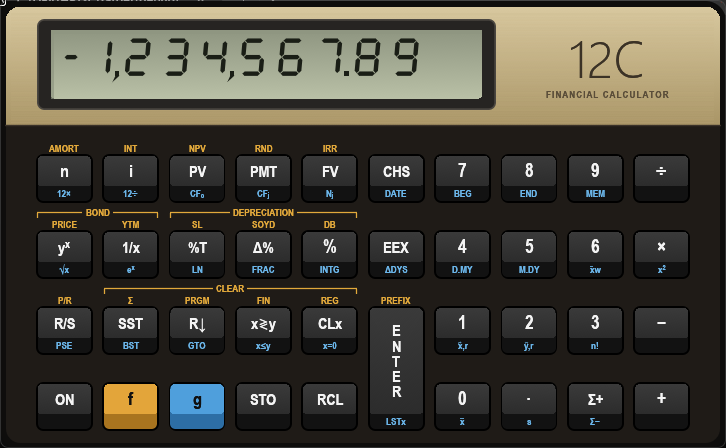

# HP-12C Emulator (Rust)

Emulador fiel da calculadora financeira **HP-12C** para Windows: mesmo visual, mesmas teclas,
lógica RPN e resultados com os mesmos 10 dígitos da máquina. Código aberto, escrito em Rust.



[](LICENSE)


> *English summary at the end of this page.*

## Baixar e usar

1. Baixe o `HP12C-<versão>-windows.zip` na página de **[Releases](https://github.com/rkiaer/hp12c-emulator-rust/releases/latest)**.
2. Descompacte e abra o `HP12C.exe`. Não precisa instalar nada (é um único arquivo de ~5 MB).
3. Clique nas teclas com o mouse ou use o teclado do computador.

> O Windows pode avisar que o programa é de "editor desconhecido", porque o executável não é
> assinado digitalmente. Clique em **Mais informações → Executar assim mesmo**.

## O que ele faz

| | |
|---|---|
| **Todas as funções da HP-12C original** | Aritmética, matemática (yˣ, LN, eˣ, n!…), juros compostos (n, i, PV, PMT, FV), NPV e IRR, amortização, juros simples, depreciação (SL, SOYD, DB), títulos (PRICE, YTM), datas (DATE, ΔDYS), estatística e regressão linear |
| **Mesma precisão** | Aritmética decimal de 10 dígitos, como a calculadora. As contas internas usam 19 dígitos e arredondam no fim |
| **Programação** | Até 99 linhas, P/R, R/S, SST, BST, GTO, testes x≤y e x=0, PSE, memória dividida com os registradores, como no original |
| **Memória contínua** | Ao fechar e abrir, tudo continua lá: pilha, registradores, programa e modos |
| **Janela de registradores (F2)** | Mostra a pilha, n/i/PV/PMT/FV, R0–R.9, fluxos de caixa e o programa, ao vivo |
| **Editor de programa (F3)** | Lista o programa com códigos e nomes (`43 35` → `x=0`); insira, apague, mova linhas ou edite como texto |
| **Copiar e colar** | Ctrl+C copia o valor de X; Ctrl+V cola um número ou um programa inteiro em texto |

### Teclado do computador

| PC | HP-12C | PC | HP-12C |
|---|---|---|---|
| 0–9, `.` `,` | dígitos, ponto | Enter | ENTER |
| `+ - * /` | + − × ÷ | Backspace / Delete | CLx |
| F / G | f / g | Tab | x≷y |
| S / R | STO / RCL | D | R↓ |
| N, I, P, M, V | n, i, PV, PMT, FV | E / C | EEX / CHS |
| Ctrl+C / Ctrl+V | copia X / cola | F2 / F3 | registradores / editor de programa |

O **botão direito** abre o menu: zoom (75–300%), sempre no topo, copiar programa, registradores,
editor, "ligar segurando" (autoteste, teste de teclado, ponto/vírgula, apagar memória) e sair.
Para mover a janela, clique fora das teclas e arraste.

## Manual

O [manual ilustrado](docs/manual-usuario.html) tem o mapa interativo do teclado, a pilha RPN
explicada passo a passo, exemplos financeiros com o resultado no display, programação e as
mensagens de erro. Baixe o arquivo (ou clone o repositório) e abra no navegador.

Um exemplo rápido, o financiamento do manual da HP: carro de 5.750 em 3 anos a 10,5% ao ano.

```text
3  g 12×     (n = 36 meses)
10.5  g 12÷  (i = 0,875% ao mês)
5750  PV
PMT          → -186.89
```

## Fidelidade

Os 240 casos de teste (teclas → display esperado) incluem os exemplos do manual da HP e valores
conferidos com implementações independentes. Ainda assim, alguns detalhes não foram comparados com
uma HP-12C física, como títulos (PRICE/YTM), o arredondamento de n e o que sobra na pilha depois de
algumas funções. Eles estão marcados com `"confirmar": true` em [`tests/vectors`](tests/vectors).
**Se você tem a calculadora e encontrar diferença, abra uma issue com as teclas e o resultado.**

Limites conhecidos: falta o palpite para IRR (`RCL g R/S`), o indicador `running` não pisca durante
i/IRR (os cálculos são instantâneos), os programas rodam mais rápido que no original e o modo
algébrico da 12C Platinum não existe.

## Para desenvolvedores

```bash
cargo test --workspace
cargo run --release
```

O núcleo (`crates/hp12c-core`) não tem dependências e não usa `unsafe`. A interface usa
[egui](https://github.com/emilk/egui), e a aparência inteira vem de [`assets/skin.json`](assets/skin.json).
Há também uma DLL com API C e um protótipo em C#/WPF que passa nos mesmos 240 testes.

Ambiente, estrutura do projeto, testes e porte para C#: **[docs/DESENVOLVIMENTO.md](docs/DESENVOLVIMENTO.md)**.
Decisões de design: [docs/SDD-HP12C.md](docs/SDD-HP12C.md).

Contribuições são bem-vindas. Para mudar um comportamento, comece por um caso em `tests/vectors`.

## Licença e aviso

Código sob a [licença MIT](LICENSE). Projeto independente, sem vínculo com a HP Inc.
"HP" e "12C" são marcas da HP Inc. Nenhum código ou ROM da HP foi usado: o comportamento foi
reimplementado a partir da documentação pública, e a arte da calculadora foi desenhada do zero.

---

## English summary

A faithful **HP-12C financial calculator emulator** for Windows, written in Rust: same look, same
keys, RPN logic and the same 10-digit decimal results. It covers every function of the original
12C: TVM, NPV/IRR, amortization, depreciation, bonds, dates, statistics and keystroke programming,
plus continuous memory, a live register viewer (F2) and a program editor (F3).

**Download:** grab `HP12C-<version>-windows.zip` from [Releases](https://github.com/rkiaer/hp12c-emulator-rust/releases/latest), unzip
and run `HP12C.exe` (portable, no install). **Build:** `cargo run --release`, see
[docs/DESENVOLVIMENTO.md](docs/DESENVOLVIMENTO.md). The UI and docs are in Portuguese. MIT licensed.
Not affiliated with HP Inc.
